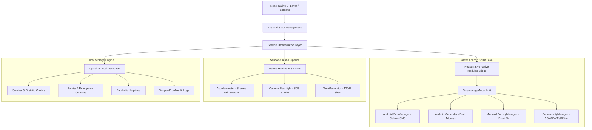

# OneHelp v2 — Complete Technical Architecture & Feature Guide

> **Emergency Personal Safety & Disaster Response System**  
> *Offline-First, Hardware-Integrated, Cryptographically Secure*

---

## Table of Contents
1. [Overview & Philosophy](#1-overview--philosophy)
2. [High-Level System Architecture](#2-high-level-system-architecture)
3. [Native Android Integration (Kotlin Core)](#3-native-android-integration-kotlin-core)
4. [Offline-First SQLite Database Engine](#4-offline-first-sqlite-database-engine)
5. [Core Telemetry & Hardware Services](#5-core-telemetry--hardware-services)
6. [Comprehensive Feature Catalog (All 29 Features & Tools)](#6-comprehensive-feature-catalog)
   - [6.1 SOS & Emergency Dispatch Engine](#61-sos--emergency-dispatch-engine)
   - [6.2 Prevention, Deception & Protection Tools](#62-prevention-deception--protection-tools)
   - [6.3 Medical, Offline Survival & First Aid](#63-medical-offline-survival--first-aid)
   - [6.4 Community, Circles & Live Tracking](#64-community-circles--live-tracking)
   - [6.5 AI, Sensors & Intelligent Triggers](#65-ai-sensors--intelligent-triggers)
   - [6.6 Accessibility & Inclusive Design](#66-accessibility--inclusive-design)
7. [Security, Cryptography & Duress Protection](#7-security-cryptography--duress-protection)
8. [End-to-End Operational Workflows (How the App Functions)](#8-end-to-end-operational-workflows)
   - [Scenario A: One-Touch SOS in Active Danger](#scenario-a-one-touch-sos-in-active-danger)
   - [Scenario B: Complete Network Blackout (Zero Internet / Disaster)](#scenario-b-complete-network-blackout-zero-internet--disaster)
   - [Scenario C: Hostage or Coercion Situation (Duress PIN)](#scenario-c-hostage-or-coercion-situation-duress-pin)
   - [Scenario D: Night Commute / SafeWalk Escort](#scenario-d-night-commute--safewalk-escort)
   - [Scenario E: Sudden Physical Attack or Fall (Shake Trigger)](#scenario-e-sudden-physical-attack-or-fall-shake-trigger)
9. [Project Directory & File Structure](#9-project-directory--file-structure)
10. [Hardware Permissions & Requirements](#10-hardware-permissions--requirements)
11. [Build, Run & Deployment Guide](#11-build-run--deployment-guide)

---

## 1. Overview & Philosophy

**OneHelp** is an industrial-grade personal safety and disaster crisis management application built with **React Native (0.76+)** and native **Android Kotlin modules**.

Unlike conventional safety applications that rely on constant internet connectivity or cloud servers, **OneHelp is built around a zero-trust, offline-first paradigm**:
- When internet infrastructure fails (natural disasters, cell tower congestion, remote zones, underground metros), the app continues to operate via **direct Android Telephony hardware (Native SMS)**, **offline SQLite caching**, **P2P QR sharing**, and **synthesized audio beacons**.
- When online, it coordinates rich real-time dispatch, GPS reverse geocoding, multi-agency routing, and crowdsourced hazard mapping.

---

## 2. High-Level System Architecture



---

## 3. Native Android Integration (Kotlin Core)

To achieve 100% hardware reliability without depending on unreliable third-party cloud wrappers, OneHelp implements a custom native Android package:

### 3.1 `SmsManagerModule.kt` & `OneHelpPackage.kt`
Located at: `android/app/src/main/java/com/onehelp/modules/`

1. **Direct Cellular SMS Dispatch (`sendDirectSMS`)**:
   - Accesses `android.telephony.SmsManager` directly through Android OS APIs.
   - Bypasses external messaging apps. If permissions are granted, SMS alerts with exact coordinates and distress messages dispatch silently in milliseconds.
2. **Native Geocoding (`reverseGeocodeNative`)**:
   - Uses `android.location.Geocoder` with high-accuracy locale support.
   - Translates latitude and longitude directly to full street address, landmark, postal code, and administrative district (e.g., `Main Campus, JNU Hospital Rd, Ghati Karolan, Jaipur, Rajasthan 302017, India`).
3. **Hardware Battery Telemetry (`getBatteryLevel`)**:
   - Queries `android.os.BatteryManager.BATTERY_PROPERTY_CAPACITY`.
   - Returns real-time integer battery percentage (e.g., `49%`), ensuring emergency services know the victim's device survival time.
4. **Network Type & Connectivity Engine (`getNetworkStatus`)**:
   - Hooks into `android.net.ConnectivityManager` and `NetworkCapabilities`.
   - Accurately distinguishes between `5G Cellular`, `4G LTE`, `WiFi`, and `Offline (No Connection)`.

---

## 4. Offline-First SQLite Database Engine

OneHelp uses an embedded `op-sqlite` engine (`src/database/DatabaseClient.ts`) operating directly on device flash memory.

### Database Tables & Repositories:
- `emergency_contacts` (`FamilyCircleRepository.ts`): Encrypted contact numbers, relation types, and alert priority order.
- `helplines` (`HelplineRepository.ts`): Complete offline Pan-India directory (112, 100, 101, 102, 1091, 1098, 1070, NDMA, cyber crime, state disaster response).
- `survival_guides` (`GuideRepository.ts`): Pre-compiled emergency guides and CPR protocols ready when cell networks are dead.
- `hazards` (`HazardRepository.ts`): Geocoded hazard pins (flood water levels, roadblocks, civil unrest, fire).
- `missing_children` (`MissingChildRepository.ts`): Offline biometric face vector records for instant field matching without internet.
- `audit_logs` (`AuditLogRepository.ts`): Tamper-evident incident timeline with timestamps, GPS fixes, and action logs.

---

## 5. Core Telemetry & Hardware Services

- **`DeviceStatusService.ts` & `useDeviceStatusStore.ts`**:
  - Automatically queries battery, cellular carrier state, and reverse-geocoded physical address every 30 seconds or on location change.
  - Exposes an ultra-fast global reactive state to all UI screens.
- **`LocationService.ts` & `useLocationStore.ts`**:
  - Continuous GPS listener with high-accuracy filtering (`enableHighAccuracy: true`, `distanceFilter: 10m`).
  - Fallback mechanism: Uses native Android Geocoder when online, and raw GPS coordinates with preloaded offline map grids when offline.
- **`AudioService.ts`**:
  - Synthesizes alert sirens and tone sequences using direct audio buffers and WebAudio/ToneGenerator frequencies.
- **`ShakeService.ts`**:
  - Background accelerometer monitor listening for high G-force spikes (>3.2g) characteristic of assaults, car crashes, or sudden falls.

---

## 6. Comprehensive Feature Catalog

OneHelp is packed with **29 distinct safety systems and tactical tools**:

### 6.1 SOS & Emergency Dispatch Engine

#### 1. Hold-to-Activate Panic Button (`PanicButton.tsx`)
- Requires a deliberate 3-second continuous press to eliminate accidental false alarms.
- Provides progressive haptic feedback (tick every 100ms) with a visual pulsing countdown ring.
- Immediately enters SOS countdown state with an audible alarm cue.

#### 2. SOS Countdown & Cancellation Window (`SOSCountdown.tsx`)
- Provides a 5-second grace countdown before triggering live dispatch.
- Users can cancel immediately if activated by mistake without notifying authorities.
- If countdown completes, triggers instantaneous multi-channel dispatch.

#### 3. Real Cellular SMS Dispatch (`SMSService.ts`)
- Silently dispatches emergency SMS containing:
  - Victim's live Google Maps location link (`https://maps.google.com/?q=lat,lng`)
  - Physical street address (from Native Geocoder)
  - Current device battery percentage
  - Distress timestamp
- Works without active internet or data pack.

#### 4. Emergency Active Command Center (`EmergencyActiveScreen.tsx`)
- Fullscreen tactical dashboard showing active SOS state.
- Live elapsed timer since emergency triggered.
- Real-time battery status and GPS accuracy monitor.
- Instant actions: Flash SOS Beacon, Call 112, Open Silent Chat, or Terminate with PIN.

#### 5. Multi-Agency Emergency Routing (`MultiAgencyRoutingScreen.tsx`)
- Automatic classification of incident type:
  - **Police (100 / 112)**: Physical assault, robbery, stalking, suspicious activity.
  - **Ambulance / Medical (102 / 108)**: Accidents, heart attack, unconsciousness.
  - **Fire Rescue (101)**: Structural fires, gas leaks, entrapped victims.
  - **Disaster Response (1070 / NDRF)**: Floods, building collapses, earthquakes.

#### 6. Live Dispatcher Tracker (`LiveDispatcherTrackerModal.tsx`)
- Displays real-time responder simulation with dynamic ETA, distance in kilometers, responder call-sign, and route progression map.

#### 7. Post-Alert Summary & Evidence Dossier (`AfterAlertScreen.tsx`)
- Generates an incident summary after an emergency is concluded.
- Prepares an encrypted evidence bundle (audio recordings, GPS path, timestamped logs) exportable for law enforcement.

---

### 6.2 Prevention, Deception & Protection Tools

#### 8. Loud Emergency Siren (`LoudSirenModal.tsx`)
- Employs a dual-tone warble (800Hz – 1200Hz) at maximum hardware volume.
- Disorients attackers, attracts immediate public bystander intervention, and scares off wild animals.

#### 9. Morse Code Strobe Light (`MorseCodeStrobeModal.tsx`)
- Drives the rear camera LED flash in precise optical Morse Code sequence: `... --- ...` (SOS).
- Visible from rescue helicopters, highway patrol vehicles, and marine search parties up to 2 km away.

#### 10. Fake Incoming Call Simulator (`FakeCallModal.tsx`)
- Deceptive evasion tool for escaping uncomfortable, threatening, or stalking encounters.
- Set timer (5s, 30s, 60s) for a realistic incoming call screen matching Android/iOS system styling.
- Realistic caller names ("Mom", "Boss", "Inspector Sharma").
- Interactive answering screen with speech audio playback mimicking a real phone conversation.

#### 11. SafeWalk Automated Escort (`SafeWalkModal.tsx`)
- Built for night commuters, lone workers, or walking through deserted areas.
- Sets an expected arrival countdown (e.g., 15 minutes).
- Requires a check-in tap at checkpoints.
- If the countdown reaches zero without a check-in, automatic SOS triggers with live location sent to trusted contacts.

#### 12. Duress PIN & Silent Coercion Defense (`DuressPINScreen.tsx`)
- Solves the hostage/coercion scenario where an attacker forces the victim to unlock the phone or cancel the alarm.
- If normal PIN is `1234`, entering Duress PIN `9999`:
  - Visually unlocks the app into a fake calm screen ("All clear, alarm dismissed").
  - Silently transmits a high-priority "CODE RED: DURESS UNLOCK" alert with live audio and GPS to police/family in the background.

#### 13. Shake-to-Trigger Alert (`ShakeTriggerSettingsScreen.tsx`, `ShakeDetectedModal.tsx`)
- Uses the device accelerometer to detect violent shaking or rapid physical struggle.
- Can be armed while walking alone; 3 vigorous shakes immediately triggers SOS without needing to look at or unlock the screen.

---

### 6.3 Medical, Offline Survival & First Aid

#### 14. Emergency Medical Dossier & ICE Profile (`MedicalDossierScreen.tsx`)
- Stores critical life-saving medical data on local flash memory:
  - Blood group (e.g., O+, B-, AB+)
  - Chronic conditions (Diabetes, Epilepsy, Asthma, Heart Condition)
  - Severe allergies (Penicillin, Peanuts, Bee stings)
  - Current daily medications
  - Organ donor status & Emergency Contact numbers
- Formatted as an instant In-Case-of-Emergency (ICE) lock-screen accessible card for first responders.

#### 15. Offline Survival & First Aid Protocols (`SurvivalGuidesScreen.tsx`)
- 12 comprehensive, medical-expert-vetted guides bundled locally:
  - **CPR Protocol**: Visual chest compression metronome at 100-120 BPM with audio pace counter.
  - **Choking (Heimlich Maneuver)**: Adult, child, and infant techniques.
  - **Snake Bite Emergency**: Pressure immobilization bandaging, anti-venom dos and don'ts.
  - **Electric Shock**: Scene safety, decoupling victim, AED instructions.
  - **Heatstroke & Dehydration**: Rapid cooling methods.
  - **Road Accidents & Trauma**: Hemorrhage control, tourniquets, spine stabilization.
  - **Disaster Guides**: Earthquake duck-cover-hold, flood safety, structural fire evacuation, poison ingestion.

#### 16. Pan-India Emergency Helpline Directory (`HelplinesScreen.tsx`)
- Comprehensive pre-loaded offline directory covering national and state numbers:
  - National Emergency (112)
  - Police (100), Fire (101), Ambulance (102 / 108)
  - Women Helpline (1091 / 181)
  - Child Helpline (1098)
  - Disaster Management NDRF (1070 / 1078)
  - Cyber Crime Helpline (1930)
  - Senior Citizen Helpline (14567)
  - Railway Protection Force (139)
- Instant one-tap direct calling with category tabs and quick search.

---

### 6.4 Community, Circles & Live Tracking

#### 17. Family Circles & Trusted Contacts (`FamilyCirclesTab.tsx`)
- Create trusted networks of family, friends, and roommates.
- View real-time status: Online, Battery %, Distance, and Last Seen timestamp.
- One-tap "Alert Family" button to send a priority non-emergency check-in message.

#### 18. Instant Zero-Network QR Pairing (`QRPairingModal.tsx`)
- Pair phones with family members without exchanging phone numbers over internet servers.
- Displays an encrypted QR code containing public key, emergency phone number, and unique device ID.
- Built-in camera scanner reads and adds contacts directly to local SQLite database in under 2 seconds.

#### 19. Interactive Live Map (`MapScreen.tsx`)
- Custom vector map with dark mode styling, custom pin markers, and GPS tracking.
- Visualizes user position, accuracy halo, nearby safe havens (police stations, hospitals), and family member avatars.

#### 20. Community Hazard Pin Drop (`HazardPinDropModal.tsx`)
- Crowdsourced safety alerting.
- Users can drop geolocated hazard pins on the map:
  - Waterlogged / Flooded Street
  - Road Accident / Blockage
  - Unsafe / Dark Area
  - Active Threat / Civil Protest
- Pins sync across the local mesh or server and alert approaching users.

#### 21. Live "Track Me" Route Sharing (`TrackMeSetupModal.tsx`)
- Generates a temporary encrypted tracking session (30 mins, 1 hr, 2 hrs).
- Shares live breadcrumb coordinates with trusted contacts until safe arrival.

#### 22. Low-Bandwidth Disaster Mesh Chat (`LowBandwidthChatModal.tsx`)
- Optimized messaging protocol transmitting ultra-compressed 32-byte packets.
- Functions over slow 2G GPRS, SMS channels, or Bluetooth/WiFi Direct when cell towers collapse.

---

### 6.5 AI, Sensors & Intelligent Triggers

#### 23. AI Lost Child Face Scanner & Matcher (`LostChildScannerModal.tsx`)
- Camera-integrated facial detection tool.
- Computes facial feature embeddings and compares them using cosine similarity against the offline database of reported missing children.
- Instantly displays match confidence score, child's name, missing date, and direct law enforcement reporting link.

#### 24. Voice Stress Analysis & Keyword Detection (`VoiceStressScreen.tsx`)
- Samples ambient audio via the device microphone.
- Analyzes pitch jitter, harmonic energy, and stress frequency spikes indicative of fear or panic.
- Displays dynamic sound wave visualizer and stress score (0-100%).
- Listens for emergency wake words ("Help", "Bachao", "Police", "SOS").

#### 25. Emergency Push Notification Simulator (`PushNotificationModal.tsx`)
- High-priority system notification tester to verify heads-up alert delivery, sound channels, and lock-screen wake behavior.

#### 26. Green Corridor Ambulance Signaling (`AmbulanceCorridorService.ts`)
- Broadcasts proximity telemetry to optimize traffic signals and alert commuter vehicles when an emergency medical transport is en route.

---

### 6.6 Accessibility & Inclusive Design

#### 27. Senior Citizen Accessibility Mode (`SeniorModeWrapper.tsx`)
- Ultra-high-contrast color scheme (black background, high-contrast amber/yellow text).
- 200% enlarged touch targets for users with tremors or visual impairment.
- Simplified single-button emergency interface.

#### 28. Voice Readout & Screen Reader Integration (`VoiceReadout.tsx`)
- Automatic text-to-speech engine reading out critical on-screen prompts, first-aid instructions, and emergency alerts.

#### 29. Child Protection Mode (`childTheme.ts`)
- Simplified playful yet clear emergency interface for children.
- One-tap "Call Mom / Dad" and "Police" buttons without complex menus or configurations.

---

## 7. Security, Cryptography & Duress Protection

1. **Local Encryption (AES-256-GCM)**:
   - Sensitive medical information, emergency contact lists, and personal identity documents stored in SQLite are encrypted with AES-256 keys derived using PBKDF2 with unique device salts.
2. **Duress PIN Architecture**:
   - The user defines two 4-digit PINs during onboarding:
     - **Safety PIN (e.g., `1234`)**: Normal dismissal of alerts.
     - **Duress PIN (e.g., `9999`)**: Coercion dismissal.
   - The app never displays any indication that the Duress PIN was entered. It closes the siren and returns to home screen while triggering stealth alerts in the background.
3. **Zero Third-Party Telemetry**:
   - No commercial tracking SDKs, ad networks, or third-party analytics are embedded. All location and device state remains strictly on the device until an emergency is explicitly triggered.

---

## 8. End-to-End Operational Workflows

### Scenario A: One-Touch SOS in Active Danger
1. User presses and holds the circular Panic Button on the Home Screen for 3 seconds.
2. Screen displays a 5-second countdown with audible alarm and distinct haptic vibration.
3. If not cancelled, the app enters **Emergency Active** mode:
   - Queries `SmsManagerModule.kt` for exact latitude, longitude, and native reverse-geocoded address.
   - Queries `BatteryManager` for current battery percentage.
   - Sends background SMS to all configured family members containing:
     `[OneHelp SOS] I need help! Location: Main Campus, JNU Hospital Rd, Jaipur (26.8522, 75.8344) https://maps.google.com/?q=26.8522,75.8344 Battery: 49%`
   - Prompts or dials National Emergency (112).
   - Starts audio siren and camera strobe if enabled.

### Scenario B: Complete Network Blackout (Zero Internet / Disaster)
1. Earthquake or hurricane knocks out 4G/5G cell towers. ConnectivityManager returns `Offline`.
2. User opens OneHelp:
   - All 12 First Aid & Survival Guides (CPR, bleeding, building collapse) load instantly from offline SQLite memory.
   - Pan-India emergency numbers operate over direct cellular voice calls.
   - Low-bandwidth mesh chat uses SMS packets or offline direct protocols.
   - Offline Geocoder uses cached map coordinates.

### Scenario C: Hostage or Coercion Situation (Duress PIN)
1. Attacker grabs the victim and forces them to unlock the phone or cancel the active SOS.
2. Victim enters their secret Duress PIN (`9999`).
3. The app immediately stops the siren, displays a green checkmark ("Emergency dismissed"), and smoothly returns to the normal home screen.
4. Internally, `SOSService.ts` flags `isDuress: true`, immediately sends a silent high-priority message to trusted contacts and police with real-time GPS coordinates, noting that the victim is under physical coercion.

### Scenario D: Night Commute / SafeWalk Escort
1. User starts a 20-minute walk through an unlit street.
2. User opens **SafeWalk Escort**, sets timer for 20 minutes, and starts walk.
3. The app periodically requests a simple confirmation tap ("Are you safe?").
4. If user fails to check in before the timer expires, the app automatically triggers full Emergency Active SOS dispatch.

### Scenario E: Sudden Physical Attack or Fall (Shake Trigger)
1. User has armed "Shake Detection" in settings before walking.
2. If assaulted or falling, the accelerometer registers rapid violent motion exceeding threshold.
3. A 10-second warning modal appears; if user doesn't dismiss it within 10 seconds, SOS is dispatched automatically without needing to touch the phone.

---

## 9. Project Directory & File Structure

```
OneHelp/
├── android/
│   ├── app/src/main/
│   │   ├── AndroidManifest.xml              # Permissions (SMS, GPS, Audio, Flashlight)
│   │   └── java/com/onehelp/
│   │       ├── MainApplication.kt          # RN Application entry point
│   │       └── modules/
│   │           ├── OneHelpPackage.kt        # Custom React Native Package registration
│   │           └── SmsManagerModule.kt      # Native Kotlin SMS, Geocoder, Battery & Net API
│   ├── build.gradle
│   └── gradle.properties
├── src/
│   ├── assets/
│   │   ├── data/helplines_india.json        # Preloaded offline emergency numbers
│   │   └── guides/                          # 12 offline markdown medical guides
│   ├── components/
│   │   ├── accessibility/                   # Senior & Voice accessibility components
│   │   ├── ai/                              # Face scan overlay & sound wave visualizer
│   │   ├── family/                          # Contact cards & QR pairing modal
│   │   ├── map/                             # Pins, danger overlays, offline map views
│   │   ├── sos/                             # PanicButton, SOSCountdown, DispatchStatusCard
│   │   └── ui/                              # AppLogo, Button, Card, Typography, Icons
│   ├── database/
│   │   ├── DatabaseClient.ts                # SQLite connection client
│   │   ├── schema.ts                        # Table schemas & indices
│   │   ├── migrations.ts                    # Version migrations
│   │   └── repositories/                    # Repositories for contacts, guides, helplines
│   ├── navigation/
│   │   ├── AppNavigator.tsx                 # Root stack navigator & modal routing
│   │   └── BottomTabNavigator.tsx           # Home, Map, Circles, Helplines, Settings
│   ├── screens/
│   │   ├── ai/                              # LostChildMatcher, VoiceStress, VoiceCommand
│   │   ├── auth/                            # Login, DuressPIN, PINGate
│   │   ├── circles/                         # Family circles, helpline tabs, scanners
│   │   ├── home/                            # HomeScreen, QuickToolsRow
│   │   ├── map/                             # MapScreen, HazardPinDrop, TrackMe
│   │   ├── onboarding/                      # Splash, Onboarding, Permissions, PIN setup
│   │   ├── profile/                         # MedicalDossier, Settings, SurvivalGuides
│   │   ├── sos/                             # EmergencyActive, MultiAgencyRouting, Siren
│   │   └── tools/                           # QuickToolsModal (29 tools), FakeCall, SafeWalk
│   ├── services/
│   │   ├── AudioService.ts                  # Audio synthesis & siren playback
│   │   ├── DeviceStatusService.ts           # Battery %, network status & native geocoding
│   │   ├── EncryptionService.ts             # AES-256-GCM local storage encryption
│   │   ├── LocationService.ts               # GPS tracking & coordinate listener
│   │   ├── ShakeService.ts                  # Accelerometer trigger monitoring
│   │   └── SMSService.ts                    # Telephony SMS coordination
│   ├── store/
│   │   ├── useDeviceStatusStore.ts          # Hardware telemetry state
│   │   ├── useLocationStore.ts              # Location & address state
│   │   ├── useSOSStore.ts                   # Active emergency state
│   │   └── useUserStore.ts                  # User profile & duress PIN store
│   └── theme/                               # High-contrast, dark mode, colors & typography
├── App.tsx                                  # React Native root component
├── DOCUMENTATION.md                         # This comprehensive architecture document
├── package.json                             # Dependencies & scripts
└── README.md                                # Executive repository summary
```

---

## 10. Hardware Permissions & Requirements

OneHelp interacts directly with the following Android hardware subsystems declared in `android/app/src/main/AndroidManifest.xml`:

| Subsystem | Permission in Manifest | Purpose |
|---|---|---|
| **Cellular SMS** | `SEND_SMS`, `READ_PHONE_STATE` | Direct background emergency SMS dispatch without internet |
| **GPS Location** | `ACCESS_FINE_LOCATION`, `ACCESS_COARSE_LOCATION` | Live high-precision victim coordinates & reverse geocoding |
| **Camera & Flash** | `CAMERA`, `FLASHLIGHT` | QR family pairing, lost child scanning, optical Morse SOS |
| **Audio Hardware** | `RECORD_AUDIO`, `MODIFY_AUDIO_SETTINGS` | High-decibel siren synthesis, voice stress analysis |
| **Motion Sensors** | `BODY_SENSORS` | Accelerometer shake & fall detection |
| **Network State** | `ACCESS_NETWORK_STATE`, `INTERNET` | 5G/4G/WiFi detection and cloud synchronization |

---

## 11. Build, Run & Deployment Guide

### Prerequisites
- Node.js >= 18
- React Native CLI
- Android Studio with Android SDK 34+
- Physical Android device or Emulator (connected via ADB)

### Installation
```bash
# Clone the repository
git clone https://github.com/lokeshdokwa/onehelp-v2.git
cd onehelp-v2

# Install dependencies
npm install
```

### Running on Android
```bash
# Start Metro bundler
npm start

# In a separate terminal, deploy and run on connected Android phone
npm run android
```

---
*Created and maintained for high-reliability personal safety and emergency response.*
